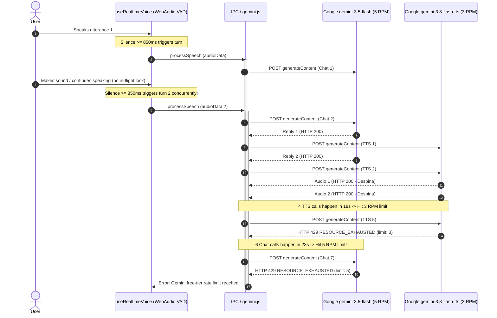

# Island — Jadu Voice Agent: Read-Only Quota & Architecture Audit

**Date of Audit**: October 21, 2026  
**Auditor**: Antigravity Assistant (Autonomous Read-Only System Audit)  
**Target Component**: Island Jadu Voice Companion (`electron/gemini.js`, `src/hooks/useRealtimeVoice.js`, `src/components/VoicePanel.jsx`)  
**Context**: Investigation into rapid free-tier quota exhaustion during voice testing after switching TTS voice from `Puck` to `Despina`.

---

## Executive Summary

1. **Why Quota Was Exhausted in Under 60 Seconds**:
   - The user tested the voice assistant at `07:22:57 UTC` (`12:52:57 IST`).
   - In a span of **56 seconds**, the client dispatched **17 API calls** (11 Chat requests to `gemini-3.5-flash` and 6 Speech Synthesis requests to `gemini-3.8-flash-tts`).
   - Within the first **23 seconds**, **11 requests** (6 chat + 5 TTS) were fired concurrently.
   - The free-tier rate limits enforced by Google are:
     - **`gemini-3.8-flash-tts`**: **3 Requests Per Minute (RPM)**
     - **`gemini-3.5-flash`** (mapped internally to `gemini-3.6-flash` quota group): **5 Requests Per Minute (RPM)**
   - Because each single conversation turn requires **2 separate API requests** (1 for LLM reasoning and 1 for TTS synthesis), completing just 2 conversation turns in under 30 seconds immediately consumes 4 API calls.
   - Worse, client-side VAD fired multiple overlapping requests because there was **no in-flight mutex / submission lock** while `gemini-3.5-flash` was generating answers. When the user continued speaking or background mic input arrived during the 4–5 second inference window, the VAD submitted additional turns concurrently.
   - At `07:23:19 UTC` (after 4 successful TTS calls), `gemini-3.8-flash-tts` hit its **3 RPM limit** and returned HTTP 429 (`RESOURCE_EXHAUSTED`).
   - At `07:23:29 UTC` (after 6 chat calls), `gemini-3.5-flash` hit its **5 RPM limit** and returned HTTP 429 (`RESOURCE_EXHAUSTED`), showing the error to the user.

2. **Did changing the voice to Despina cause the failure?**:
   - **No.** The voice change from `Puck` to `Despina` was completely successful. Despina successfully spoke 4 separate times (`07:23:00`, `07:23:03`, `07:23:07`, `07:23:17 UTC`) with HTTP 200 responses.
   - The failure was strictly an **architectural amplification issue**: high VAD sensitivity, zero request throttling, zero concurrency locking, and a 2-call-per-turn design running against tight Google Free-Tier rate limits (3 RPM for TTS and 5 RPM for Chat).

---

## Part A — Architectural Audit

### 1. Model IDs Configured
| Stage | Configured Endpoint / Target | Model ID in Payload | Google Quota Group Reported |
|---|---|---|---|
| **Audio Understanding & Chat** | `/v1beta/models/gemini-3.5-flash:generateContent` | `gemini-3.5-flash` | `gemini-3.6-flash` |
| **Speech Synthesis (TTS)** | `/v1beta/models/gemini-3.8-flash-tts:generateContent` | `gemini-3.8-flash-tts` | `gemini-3.8-flash-tts` |

- **Endpoint details**: Direct Google Generative Language REST API (`generativelanguage.googleapis.com`) using Node.js `https.request` in the Electron main process (`electron/gemini.js`).

### 2. TTS Voice Configuration
- **Current Default Voice**: `'Despina'` (configured as fallback default in `gemini.js` lines 331, 428, 476, and 492).
- **Renderer Call**: In `src/hooks/useRealtimeVoice.js` line 266, `window.island.gemini.processSpeech({ audioData, history, petName, userName })` is called without passing an explicit `voice` parameter; hence it defaults to `'Despina'`.

### 3. API Requests Per Completed Conversation Turn
- **2 API requests per single user turn**:
  1. **Request 1 (Chat/Multimodal)**: User WAV audio data + system prompt + history is sent to `gemini-3.5-flash:generateContent`. Duration: ~3,700ms – 5,300ms.
  2. **Request 2 (TTS)**: The text output from Request 1 is immediately sent to `gemini-3.8-flash-tts:generateContent` with `responseModalities: ['AUDIO']` and `voiceName: 'Despina'`. Duration: ~2,600ms – 4,200ms.
- **Combined turn latency**: ~6.5 to 9.5 seconds per turn.

### 4. VAD Behavior & Extra Request Triggering
- **Mechanism**: Client-side `ScriptProcessorNode` (buffer size 2048) in `src/hooks/useRealtimeVoice.js`.
- **Speech Threshold**: `rms > 0.02` flags speech activity (`isUserSpeakingRef.current = true`).
- **Silence Timeout**: **850ms**. When RMS drops below 0.02, `silenceTimerRef` starts a 850ms timeout.
- **Minimum Duration Filter**: In `submitUserSpeech`, utterances shorter than `0.4` seconds (400ms) are dropped.
- **Amplification Risk**:
  - 850ms of silence is very brief for natural human speech (e.g. taking a breath or pausing between clauses).
  - If a user pauses for 900ms mid-sentence, the first fragment is sent immediately. When the user resumes speaking, a second fragment is sent as another complete turn.

### 5. Concurrency & Overlapping Requests
- **Confirmed Vulnerability: Overlapping requests ARE occurring.**
- While `submitUserSpeech` updates React state to `setStatus('thinking')`, **the `scriptProcessor.onaudioprocess` handler does NOT check if a request is in flight**.
- Because `onaudioprocess` runs on the Web Audio audio thread, it continues capturing microphone chunks. If the user makes any sound while the LLM is responding, `isUserSpeakingRef` becomes true and triggers a second `submitUserSpeech` before the first one completes.
- In the diagnostic log, **Chat Request 2 was dispatched at `07:22:59.716Z` while Chat Request 1 (dispatched at `07:22:57.619Z`) was still waiting for an API response**.

### 6. Conversation History Payload Structure
- **Multi-Turn History**:
  - The last 6 history items are attached as text-only parts: `contents: [{ role: 'user'|'model', parts: [{ text: item.text }] }]`.
  - When user speaks via mic, the history records a placeholder: `{ role: 'user', text: 'Voice message to <petName>' }`.
- **Current Turn**:
  - Attached with base64 inline PCM audio:
    ```json
    {
      "role": "user",
      "parts": [
        {
          "inlineData": {
            "mimeType": "audio/wav",
            "data": "<BASE64_PCM_16BIT_16KHZ>"
          }
        },
        {
          "text": "Listen carefully to my voice and respond to me, Friend, in under 2 sentences."
        }
      ]
    }
    ```
- Audio from previous turns is **not** retained or re-uploaded (only text history is retained).

### 7. TTS Failure Handling
- In `electron/gemini.js` lines 447–456, when `gemini-3.8-flash-tts` returns an error or HTTP 429:
  - The service records `ttsDiagnostics` with `failedModel: 'gemini-3.8-flash-tts'`.
  - It returns `{ ok: true, text: replyText, audioBase64: null, ttsError: ... }`.
  - In `useRealtimeVoice.js`, it falls back to rendering the text transcript in the UI without sound.
  - **TTS failures do NOT retry or trigger additional Gemini calls.**

### 8. Cooldowns, Queueing, and Retry Protection
- **Cooldowns**: None.
- **Queueing**: None.
- **Retry Protection**: The application extracts `retryDelay` and Google's `RetryInfo` headers in `_extractErrorDetails`, but **this value is never used to lock the UI or disable calls**.
- When an error occurs, the user can click "Retry" repeatedly or speak into the mic, immediately sending new HTTP requests and incurring further 429 rejections.

---

## Part B — Diagnostic Log Findings (`gemini-diagnostics.jsonl`)

**File Location**: `C:\Users\harsh\AppData\Roaming\Island\gemini-diagnostics.jsonl` (size: 11,305 bytes, 23 total records).

### 1. Overall Request Breakdown (All 23 Records)

| Category | Chat (`gemini-3.5-flash`) | TTS (`gemini-3.8-flash-tts`) | Total |
|---|---|---|---|
| **Total Requests Recorded** | 17 | 6 | 23 |
| **Successful (HTTP 200)** | 6 | 4 | 10 |
| **Rejected (HTTP 429 Quota Exhausted)** | 11 | 2 | 13 |
| **Network / Parse / Timeout Errors** | 0 | 0 | 0 |

### 2. Session Analysis

#### Session 1: Pre-Test Morning Run (`04:48:14 UTC` / `10:18:14 IST`)
- **Records 1 to 6**: 6 consecutive chat requests, all rejected with HTTP 429.
- Error message: `* Quota exceeded for metric: generativelanguage.googleapis.com/generate_content_free_tier_requests, limit: 20, model: gemini-3.6-flash. Please retry in 2h11m...`
- `retryDelay`: ~7,900s (~2.2 hours).
- Indicates that the daily/hourly tier limit was previously exhausted earlier in the morning.

#### Session 2: Despina Voice Session (`07:22:57 UTC` to `07:23:53 UTC` / `12:52:57 IST` to `12:53:53 IST`)
- **Total Duration**: 56 seconds.
- **Total Requests**: 17 requests in 56 seconds.

**Chronological Sequence of the Despina Session**:

1. **`07:22:57.619Z` (12:52:57 IST)** — `gemini-3.5-flash` [Chat]: **HTTP 200 OK** (4,460ms).  
   *Tokens: Prompt 164, Output 19, Total 276.*
2. **`07:22:59.716Z` (12:52:59 IST)** — `gemini-3.5-flash` [Chat]: **HTTP 200 OK** (4,009ms). **[OVERLAPPED]**  
   *Tokens: Prompt 167, Output 15, Total 245.*
3. **`07:23:00.284Z` (12:53:00 IST)** — `gemini-3.8-flash-tts` [TTS]: **HTTP 200 OK** (2,655ms). **[DESPINA SPOKE 1]**  
   *Tokens: Prompt 19, Output 111, Total 130.*
4. **`07:23:03.951Z` (12:53:03 IST)** — `gemini-3.8-flash-tts` [TTS]: **HTTP 200 OK** (4,232ms). **[DESPINA SPOKE 2]**  
   *Tokens: Prompt 15, Output 84, Total 99.*
5. **`07:23:04.072Z` (12:53:04 IST)** — `gemini-3.5-flash` [Chat]: **HTTP 200 OK** (3,749ms).  
   *Tokens: Prompt 186, Output 16, Total 347.*
6. **`07:23:07.905Z` (12:53:07 IST)** — `gemini-3.8-flash-tts` [TTS]: **HTTP 200 OK** (3,832ms). **[DESPINA SPOKE 3]**  
   *Tokens: Prompt 16, Output 103, Total 119.*
7. **`07:23:14.817Z` (12:53:14 IST)** — `gemini-3.5-flash` [Chat]: **HTTP 200 OK** (5,283ms).  
   *Tokens: Prompt 222, Output 18, Total 345.*
8. **`07:23:17.818Z` (12:53:17 IST)** — `gemini-3.8-flash-tts` [TTS]: **HTTP 200 OK** (2,998ms). **[DESPINA SPOKE 4]**  
   *Tokens: Prompt 18, Output 102, Total 120.*
9. **`07:23:18.990Z` (12:53:18 IST)** — `gemini-3.5-flash` [Chat]: **HTTP 200 OK** (5,238ms).  
   *Tokens: Prompt 273, Output 10, Total 380.*
10. **`07:23:19.374Z` (12:53:19 IST)** — `gemini-3.8-flash-tts` [TTS]: **HTTP 429 RESOURCE_EXHAUSTED** (381ms).  
    - **Failed Model**: `gemini-3.8-flash-tts`  
    - **Reported Quota**: `metric: generativelanguage.googleapis.com/generate_content_free_tier_requests, limit: 3, model: gemini-3.8-flash-tts`  
    - **Retry Delay**: `40s` (earliest retry: `07:24:00 UTC` / `12:54:00 IST`).  
    - *Note: At this moment, TTS failed silently and fell back to text-only mode.*
11. **`07:23:20.894Z` (12:53:20 IST)** — `gemini-3.5-flash` [Chat]: **HTTP 200 OK** (4,959ms).  
    *Tokens: Prompt 248, Output 20, Total 391.*
12. **`07:23:21.229Z` (12:53:21 IST)** — `gemini-3.8-flash-tts` [TTS]: **HTTP 429 RESOURCE_EXHAUSTED** (333ms).  
    - **Failed Model**: `gemini-3.8-flash-tts` (limit: 3, retry in 39s).
13. **`07:23:29.500Z` (12:53:29 IST)** — `gemini-3.5-flash` [Chat]: **HTTP 429 RESOURCE_EXHAUSTED** (513ms).  
    - **Failed Model**: `gemini-3.5-flash` (reported as `model: gemini-3.6-flash`)  
    - **Reported Quota**: `limit: 5, model: gemini-3.6-flash`  
    - **Retry Delay**: `30s` (earliest retry: `07:24:00 UTC` / `12:54:00 IST`).  
    - *User sees error modal: "Gemini free-tier rate limit reached. Please wait a moment and retry."*
14. **`07:23:32.297Z` (12:53:32 IST)** — `gemini-3.5-flash` [Chat]: **HTTP 429** (363ms, retry in 28s).
15. **`07:23:33.867Z` (12:53:33 IST)** — `gemini-3.5-flash` [Chat]: **HTTP 429** (405ms, retry in 26s).
16. **`07:23:46.804Z` (12:53:46 IST)** — `gemini-3.5-flash` [Chat]: **HTTP 429** (660ms, retry in 13s).
17. **`07:23:53.228Z` (12:53:53 IST)** — `gemini-3.5-flash` [Chat]: **HTTP 429** (564ms, retry in 7s).

### 3. Latest Failure Details
- **Timestamp**:
  - UTC: `2026-10-21T07:23:53.228Z`
  - Local (IST, UTC+5:30): `2026-10-21 12:53:53.228 IST`
- **HTTP Status**: `429`
- **Failed Stage**: `chat`
- **Requested Model**: `gemini-3.5-flash`
- **Model Mentioned in Google Quota Error**: `gemini-3.6-flash`
- **Quota Metric**: `generativelanguage.googleapis.com/generate_content_free_tier_requests`
- **Quota Limit**: `5` requests per minute
- **Retry Delay Reported**: `7s`
- **Calculated Earliest Safe Retry Time**: `2026-10-21T07:24:00.329Z` (`12:54:00.329 IST`)

### 4. Recorded Token Usage Summary
- Across all 10 successful calls in the test:
  - **Chat Prompt Tokens**: between 164 and 273 tokens per request.
  - **Chat Output Tokens**: concise, between 10 and 20 tokens per response.
  - **Chat Total Tokens**: between 245 and 391 tokens per turn.
  - **TTS Prompt Tokens**: between 15 and 19 characters/tokens.
  - **TTS Output Tokens (Audio frames)**: between 84 and 111 audio tokens.
- **Thinking Tokens**: `null` (uncounted / disabled).
- **Rejected Calls**: On HTTP 429 errors, Google does not process tokens, so token counts are recorded as `null`.

---

## Part C — Technical Architecture Review & Recommendations

### Summary of Discovered Vulnerabilities



1. **Dual-API Turn Multiplier**:
   - Because audio intelligence and TTS are two distinct endpoints, every user utterance consumes **2 quota units**.
   - With Google's TTS free-tier cap at **3 RPM**, a user can only have **1.5 completed turns per minute** before TTS fails.

2. **Absence of In-Flight Mutex in `useRealtimeVoice`**:
   - `onaudioprocess` continuously captures microphone audio and schedules `submitUserSpeech` even while an existing `processSpeech` call is active.
   - When users speak slowly, pause, or murmur during the 4-second LLM inference delay, multiple overlapping turns are dispatched.

3. **Overly Sensitive VAD Silence Threshold (850ms)**:
   - 850ms is shorter than common conversational hesitation pauses.

4. **Lack of Rate Limit Backoff / Lockout**:
   - The diagnostic engine successfully extracts Google's `retryDelay` (e.g. `40s`, `30s`, `7s`), but the UI fails to disable the microphone or retry buttons during the active retry window.

---

### Non-Breaking Suggested Optimizations (For Future Implementation)

1. **Add In-Flight Turn Locking**:
   - In `useRealtimeVoice.js`, add `isSubmittingRef.current = true`. Ignore or defer VAD chunk accumulation until `submitUserSpeech` finishes playing or resolving.
2. **Increase VAD Silence Threshold**:
   - Increase VAD silence hold from `850ms` to `1,400ms`–`1,600ms` to avoid slicing a single sentence into two turns.
3. **Enforce Cooldown / Backoff Window**:
   - When Google returns HTTP 429 with `retryDelay` (e.g. 30s), set a countdown timer in `useRealtimeVoice`. Disable the mic and show a friendly countdown: *"Jadu is catching its breath (25s)..."* instead of letting the user hammer the API.
4. **Local OS TTS Fallback for Quota Exhaustion**:
   - If `gemini-3.8-flash-tts` hits its 3 RPM rate limit, seamlessly fall back to local Windows SAPI / Web Speech API (`window.speechSynthesis`) rather than going completely silent or failing.
5. **Single-Hop Gemini Multimodal Live / Bidi API or Audio Output (Future Phase)**:
   - When Gemini 2.0 / Flash Native Audio becomes available in the project, query single-call audio-in/audio-out to halve the requests from 2 to 1 per turn.

---

### Unknowns Requiring Further Observation
1. **Google Free-Tier Daily Quota Replenishment**:
   - The morning diagnostic log showed limit `20` with a 2-hour delay. It appears Google applies both a per-minute limit (3 RPM for TTS, 5 RPM for Chat) and an hourly/daily request cap for new API keys on the free tier.
2. **Paid Pay-As-You-Go Tier Comparison**:
   - On the Blaze (Pay-As-You-Go) tier, limits jump from 3–5 RPM to 1,000–2,000 RPM, eliminating rate-limit errors entirely for typical conversational usage.
